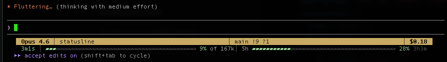

# claude-statusline

A custom statusline for [Claude Code](https://docs.anthropic.com/en/docs/claude-code) written in Rust. Shows model, cost, duration, git branch, context usage, and more — rendered as a two- or three-line bar with ANSI colors.



Run it directly to see a demo preview with test data:

```
claude-statusline
```

## Install

macOS or Linux (x86_64/arm64), no Rust toolchain needed:

```
curl -fsSL https://raw.githubusercontent.com/brannow/claude-statusline/main/install.sh | sh
```

This downloads the latest release binary to `~/.local/bin/claude-statusline`, verifies its SHA-256, and sets `statusLine` in `~/.claude/settings.json` (an existing file is backed up next to it first). Re-run the same command to update: it skips the download when you're already on the latest release (`CLAUDE_STATUSLINE_FORCE=1` reinstalls anyway).

Options go on `sh`, not on `curl`:

```
curl -fsSL https://raw.githubusercontent.com/brannow/claude-statusline/main/install.sh \
  | CLAUDE_CONFIG_DIR=~/.claude-work CLAUDE_STATUSLINE_INSTALL_DIR=/usr/local/bin sh
```

| Variable | Default |
|---|---|
| `CLAUDE_CONFIG_DIR` | `~/.claude` |
| `CLAUDE_STATUSLINE_INSTALL_DIR` | `~/.local/bin` |
| `CLAUDE_STATUSLINE_VERSION` | latest release, e.g. `v0.2.0` |

To only (re)point an already installed binary at a config dir: `claude-statusline --configure`.

## Build from source

```
make install
```

Installs to `/usr/local/bin/claude-statusline`.

## Configure Claude Code manually

Add to `~/.claude/settings.json`:

```json
{
  "statusLine": {
    "type": "command",
    "command": "/usr/local/bin/claude-statusline"
  }
}
```

If installed to a non-standard path, use the full path instead.

## Features

**Line 1** — model name, directory, git branch + status (staged/modified/untracked), agent name, permission mode

**Line 2** — session duration, context window gauge (adjusted for autocompact buffer), total cost

**Line 3** *(optional)* — 5h and 7d usage bars with percentage and reset countdown. Shown only when `rate_limits` is present in Claude Code's stdin JSON (requires Claude Code ≥ v2.1.80).

Segments are dropped right-to-left when the terminal is too narrow to fit them all.

No Nerd Fonts or Powerline glyphs required — uses standard Unicode only (▐ ▌ ▰ ▱).

### Edge cases handled

- **Accounts without 7-day limits** — Some subscription tiers only have a 5-hour window. The 7d bar is simply omitted when absent.
- **Context window accuracy** — The gauge subtracts Claude Code's ~33k autocompact buffer, showing percentage of *usable* capacity. 100% means autocompact will trigger.
- **Git timeout protection** — Git runs in a separate thread with a 500ms timeout and results are cached for 5s. Slow repos (large monorepos, network mounts) won't block the statusline.
- **Crash resilience** — The entire `run()` is wrapped in `catch_unwind`. A statusline must never crash the host terminal.
- **Per-session color palette** — Each session gets a deterministic color from a 12-color palette, hashed from session ID or cwd, so concurrent sessions are visually distinct.

## Debug

Pass `--debug` to dump raw JSON input to `/tmp/claude-statusline-debug-<session>/`.
